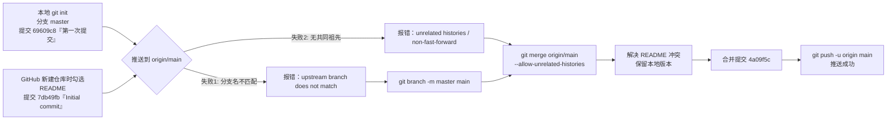

# Git 从建项到上传云端：问题记录与排错手册

> 本文记录 **TetrisM** 项目从本地初始化到成功推送到 GitHub 的全过程，包含实际踩到的 3 个坑、修复命令、验证方法与日后避坑清单。
> 适用环境：Windows + Git 2.56.0.windows.2 + GitHub（HTTPS 协议）。

---

## 一、环境与仓库信息

| 项目 | 值 |
|---|---|
| 本地路径 | `d:\project\TetrisM` |
| 远程仓库 | `https://github.com/zmm225/TetrisM.git` |
| 远端名 | `origin` |
| Git 版本 | `git version 2.56.0.windows.2` |
| 全局 `init.defaultBranch` | `master`（未修改，故 `git init` 默认建 `master`） |
| `push.default` | 未设置 → 默认 `simple` |
| 提交者 | `张明明 <zmmwsby@163.com>` |

---

## 二、整体时间线



最终历史：

```
*   4a09f5c (HEAD -> main, origin/main, origin/HEAD) Merge remote-tracking branch 'origin/main' into main
|\
| * 7db49fb Initial commit          ← GitHub 上创建仓库时自动生成
* 69609c8 第一次提交                 ← 本地代码提交（孤立根提交）
```

---

## 三、四类实际问题

### 问题 1：本地 `master` 与远程 `main` 名字不一致（直接导致 push 失败）

**现象**

```bash
$ git push
fatal: The upstream branch of your current branch does not match
the name of your current branch.  To push to the upstream branch
on the remote, use

    git push origin HEAD:main

To push to the branch of the same name on the remote, use

    git push origin HEAD

To choose either option permanently, see push.default in 'git help config'
```

**原因**

| 项 | 值 |
|---|---|
| 本地分支 | `master` |
| 上游配置 | `branch.master.remote = origin`、`branch.master.merge = refs/heads/main` |
| `push.default` | 未设置 → `simple` |

`push.default = simple` 要求 **本地分支名必须与上游分支名相同**。`master`(本地) → `main`(远程) 名称不同，git 出于防止误推的考虑直接拒绝，并且**不给任何提示性交互**，看起来就像"一直推送不了"。

> 配置来源：`git branch -vv` 会显示 `[origin/main: ahead 1, behind 1]`，可据此判断是否跟踪了同名分支。

**修复**

```bash
# 方案 A（推荐）：本地改名，与 GitHub 默认分支对齐
git branch -m master main

# 方案 B：只改上游跟踪关系，不改名
git branch -u origin/main master   # 仍然会因名字不同而失败，需配合方案 C

# 方案 C：一次性地显式推送
git push -u origin master:main
```

本项目采用 **方案 A**。

---

### 问题 2：本地与远程是两段「无共同祖先」的历史（unrelated histories）

**现象**

```bash
$ git pull
fatal: refusing to merge unrelated histories

$ git push origin HEAD:main
! [rejected]  HEAD -> main (non-fast-forward)
error: failed to push some refs to 'https://github.com/zmm225/TetrisM.git'
hint: Updates were rejected because the tip of your current branch is behind
```

`git status` 显示：

```
On branch master
Your branch and 'origin/main' have diverged,
and have 1 and 1 different commits each, respectively.
```

**原因**

- 本地 `69609c8` 是 **孤立根提交**（`git rev-list --parents -n 1 69609c8` 只输出自身，无父提交）。
- 远程 `7db49fb` 也是 GitHub 在新建仓库时（勾选 "Add a README file"）创建的**另一个孤立根提交**。
- 两者没有共同祖先，git 认为"合并两个无关项目"具有高风险，默认拒绝。

**修复**

```bash
# 1) 拉取远程对象（不自动合并）
git fetch origin

# 2) 允许合并无关历史
git merge origin/main --allow-unrelated-histories --no-edit
```

> 若本地代码尚未提交，也可改用变基方式（历史更干净）：
> ```bash
> git pull --rebase origin main --allow-unrelated-histories
> ```

---

### 问题 3：`README.md` 的 add/add 冲突

**现象**

```bash
Auto-merging README.md
CONFLICT (add/add): Merge conflict in README.md
Automatic merge failed; fix conflicts and then commit the result.
```

`git status --short` → `AA README.md`（两边的文件都被"新增"，无法三方合并）。

冲突文件内容形如：

```
<<<<<<< HEAD
# 俄罗斯方块小游戏（TetrisM）
...（本地完整文档，21 行）
=======
# TetrisM
自己练习小游戏,俄罗斯方块
>>>>>>> origin/main
```

**原因**

两边都**新建**了 `README.md`，没有共同基线版本，git 无法判断谁是"修改"，只能标记为 add/add 冲突。

**修复（保留本地完整版）**

```bash
# --ours  = 当前分支（本地 main）的版本；--theirs = 被合并进来的一侧
git checkout --ours README.md
git add README.md
git commit --no-edit        # 结束合并，生成合并提交
```

**验证保留的正是原始文件**

```bash
git hash-object README.md          # 工作区内容哈希
# 与本地原提交中的 blob 一致即说明未被改写
git rev-parse 69609c8:README.md
```

本项目结果：`1643b7bbab719ab48eac5b85f01f67b7b8292505` 两边一致，说明本地 README 一字未改。

---

### 问题 4：网络层失败（与 Git 配置无关，最容易被误判）

配置全部正确、远端也一致时，仍可能推送失败：

```bash
$ git push
fatal: unable to access 'https://github.com/zmm225/TetrisM.git/':
       Recv failure: Connection was reset

# 或者
fatal: unable to access 'https://github.com/zmm225/TetrisM.git/':
       Failed to connect to github.com:443 after 21054 ms: Could not connect to server
```

**判断方法：先确认是不是网络，再怀疑 Git**

```bash
# 1) TCP 443 能否连通（False = 网络不通，与 git 无关）
Test-NetConnection -ComputerName github.com -Port 443 -InformationLevel Quiet

# 2) 是否有代理配置冲突
git config --get http.proxy
git config --get https.proxy
echo $env:HTTP_PROXY $env:HTTPS_PROXY

# 3) 远程地址是否可读（只读操作，不受 push 权限影响）
git ls-remote origin
```

**常见成因**

| 成因 | 表现 | 处理 |
|---|---|---|
| 网络波动 / DNS 污染 / 代理失效 | `Connection was reset`、`Could not connect` | 稍后重试；切换网络或代理 |
| 公司/校园网屏蔽 443 | 一直超时约 21s | 换网络、配置代理 |
| `http.proxy` 指向已失效的代理 | `Failed to connect to 127.0.0.1:7890` | `git config --global --unset http.proxy` |
| 凭证过期 | `Authentication failed` / `403` | 清理 Windows 凭据管理器中的 GitHub 凭据后重试 |

> 若失败发生在 `git push` 之后但**已产生本地提交**，无需回滚：网络恢复后直接再执行一次 `git push` 即可，git 是幂等的。
> 本文档提交时就遇到过该情况，本地 `9157827` 已生成，等网络恢复后 `git push` 完成同步。

---

## 四、最终成功的完整命令序列

```bash
# 0) 查看现状，确认问题
git status
git remote -v
git branch -vv
git log --oneline --graph --all

# 1) 本地分支改名，与远程 main 对齐
git branch -m master main

# 2) 拉取远程并允许合并无关历史
git fetch origin
git merge origin/main --allow-unrelated-histories --no-edit

# 3) 解决 README.md 的 add/add 冲突（保留本地版本）
git checkout --ours README.md
git add README.md
git commit --no-edit -m "Merge remote-tracking branch 'origin/main' into main"

# 4) 推送并建立上游跟踪
git push -u origin main
# 输出：7db49fb..4a09f5c  main -> main
#        branch 'main' set up to track 'origin/main'.
```

---

## 五、验证是否真的推送成功

```bash
# 1) 本地与远程指向同一个提交？
git rev-parse HEAD
git ls-remote origin refs/heads/main
# 两者哈希必须相同

# 2) 领先/落后计数应为 0 0
git rev-list --left-right --count HEAD...origin/main

# 3) 普通 git push 应无报错
git push --dry-run          # Everything up-to-date，退出码 0
git status -sb              # ## main...origin/main（无 ahead/behind 字样）

# 4) 远程确实包含项目文件
git ls-tree -r --name-only origin/main
```

本次结果：

```
local  = 4a09f5c205bd78c495e87e0c36b0caa119a82083
remote = 4a09f5c205bd78c495e87e0c36b0caa119a82083
ahead/behind = 0  0
远程文件：.gitignore README.md game.js game.json js/*.js project*.json res/music/*.mp3（共 13 个）
```

---

## 六、日后避免同样问题：正确起手式

### 场景 A：先有本地代码，再建云端仓库（本项目属于这种）

```bash
# 1. 本地初始化（-b main 显式指定分支名，避免依赖全局默认值 master）
git init -b main

# 2. 首次提交
git add -A
git commit -m "第一次提交"

# 3. 关联远程（GitHub 建仓库时**不要**勾选 Add a README / .gitignore / license）
git remote add origin https://github.com/<user>/<repo>.git

# 4. 首次推送并建立上游
git push -u origin main
```

> 关键点：**GitHub 建仓库时留空（不生成 README）**，就不会产生第二条孤立历史，`push -u origin main` 一次成功。

### 场景 B：云端仓库已有提交，本地是空目录

```bash
git clone https://github.com/<user>/<repo>.git
cd <repo>
# 把代码复制进来，再 add/commit/push
```

### 场景 C：已经有仓库、只想切换新分支开发

```bash
git switch -c dev          # 2.23+ 推荐（替代 git checkout -b）
git push -u origin dev     # 必须带 -u，否则 push 会报 no upstream branch
```

---

## 七、避坑清单（Checklist）

- [ ] **分支同名**：本地分支与远程分支同名，`git branch -vv` 显示的 `[origin/xxx]` 与当前分支名一致。
- [ ] **`init.defaultBranch`**：Git 2.56 在 Windows 上常见默认值仍是 `master`，而 GitHub 默认 `main`。用 `git init -b main` 或 `git config --global init.defaultBranch main` 一次性对齐。
- [ ] **GitHub 建仓库别勾 README**：会造成 unrelated histories，多一次手工合并。
- [ ] **`push.default` 保持 `simple`**（默认值）即可，不要为了绕过报错改成 `current` / `matching`，那会掩盖真正的分支错配。
- [ ] **`no upstream branch` 报错**：`git push -u origin <branch>`。
- [ ] **`non-fast-forward` 报错**：先 `git pull --rebase`；**不要**直接 `--force`，多人协作会覆盖他人提交；确实要改写历史用 `--force-with-lease`。
- [ ] **`.gitignore` 先写再提交**：本项目当前内容为
      ```
      .vscode/
      .graphflow/
      ```
- [ ] **敏感/私有配置不入库**：`project.private.config.json` 是微信开发者工具的**本机私有配置**（含本地路径、编译设置），官方建议不提交。目前它**已被跟踪**，需要时可执行：
      ```bash
      git rm --cached project.private.config.json
      echo "project.private.config.json" >> .gitignore
      git commit -m "chore: 停止跟踪 project.private.config.json"
      ```
- [ ] **别把自动生成的 checkpoint ref 当分支**：`refs/agents/<uuid>/checkpoints/turn/N` 是工具环境（如 Copilot 会话）自动打的快照，会出现在 `git log --all` 里但**不属于任何分支**。看历史时加 `--branches` 或直接 `git log --oneline` 即可，不要误以为有幽灵提交。
- [ ] **确认 GitHub 默认分支**：仓库 Settings → Branches → Default branch 应指向 `main`，否则新克隆者会拿到错误分支。

---

## 八、当前仓库状态速查（本文档写作时）

```
分支：* main  78277ec [origin/main: ahead 1]  ← 当前 HEAD，多出的一笔是本文档提交
      dev   78277ec                          ← 已与 main 对齐，但没有上游

远程：origin/main = 4a09f5c（合并提交，尚未收到本文档提交）
工作区：clean
```

> **待办：** 本文档提交时 GitHub 网络不可达（`Failed to connect to github.com:443`），
> 网络恢复后执行一次 `git push` 即可同步，无需任何回滚操作：
> ```bash
> git push            # 位于 main 上，上游已配置，直接推送
> git rev-list --left-right --count HEAD...origin/main   # 期望输出 0  0
> ```
>
> **注意 `dev` 分支：** 它没有上游。在 `dev` 上直接 `git push` 会报
> `fatal: The current branch dev has no upstream branch`，首次推送需：
> ```bash
> git push -u origin dev
> ```
> 只想在主线上工作的话：`git switch main`。

---

## 九、命令 / 概念速查

| 命令 | 作用 |
|---|---|
| `git init -b main` | 初始化并直接指定初始分支名 |
| `git branch -m 旧名 新名` | 重命名本地分支 |
| `git branch -vv` | 查看分支及其上游跟踪关系 |
| `git branch -u origin/main` | 为当前分支设置上游（不推送） |
| `git remote -v` | 查看远程地址 |
| `git fetch origin` | 只下载远程对象，不合并 |
| `git merge --allow-unrelated-histories` | 允许合并没有共同祖先的两段历史 |
| `git log --oneline --graph --decorate --all` | 图形化查看全部历史（含非分支 ref） |
| `git rev-list --left-right --count A...B` | 统计两端的领先/落后提交数 |
| `git rev-parse HEAD` / `git ls-remote origin refs/heads/main` | 比对本地与远程指向的提交 |
| `git ls-remote origin` | 读取远程分支列表（只读，用于验证连通性） |
| `Test-NetConnection -ComputerName github.com -Port 443` | 检测到 GitHub 的网络连通性 |
| `git push -u origin main` | 推送并建立上游跟踪 |
| `git push --force-with-lease` | 安全强推（远程被别人更新过时会失败而非覆盖） |
| `git checkout --ours <file>` / `--theirs` | 冲突时保留我方 / 对方版本 |
| `git rm --cached <file>` | 取消跟踪但保留本地文件 |

| 报错关键字 | 含义 | 对应处理 |
|---|---|---|
| `upstream branch ... does not match` | 本地/上游分支名不同 | 改名或显式 `origin HEAD:main` |
| `refusing to merge unrelated histories` | 两段历史无共同祖先 | `--allow-unrelated-histories` |
| `non-fast-forward` | 远程有你没有的提交 | `pull --rebase` 后重推 |
| `no upstream branch` | 新分支未设上游 | `push -u origin <branch>` |
| `CONFLICT (add/add)` | 两边都新建了同一文件 | 手工选择内容后 `add` |
| `Recv failure: Connection was reset` | 网络中断 / 代理问题 | 重试；检查 `Test-NetConnection github.com -Port 443` |
| `Failed to connect to github.com:443` | 网络不通或被墙 | 换网络 / 配代理 |
| `Authentication failed` / `403` | 凭据失效或无权限 | 清理凭据管理器后重新认证 |
| `Everything up-to-date` | 已同步，无需操作 | 正常 |
